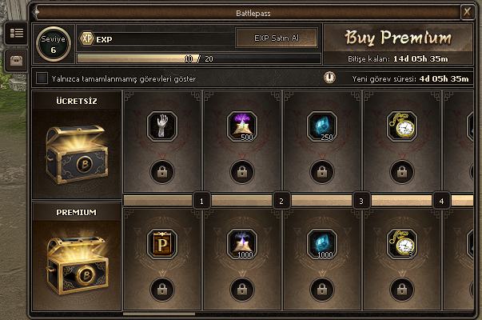

# Battlepass System

Sezonluk savaş bileti. Ücretsiz ve premium ödül hattı, günlük / haftalık görevler, seviye ödülleri ve sezon sayacı tek pencerede.



---

## Ne var?

- İlerleme ayrı tablolarda: `battlepass_progress` ve `battlepass_mission` (`03. Server/mysql/battlepass_tables.sql`). Girişte sadece aktif sezon async okunur; ödül / premium / seviye anında, görev sayaçları 60 sn'de bir ve çıkışta toplu yazılır
- Battlepass penceresi (`uibattlepass.py`)
- Görev ilerlemesi sunucudan anlık gelir (`battlepass_renewal.cpp`)
- Ödül ve görev ayarları `locale/common/config_json/battlepass_config.json`
- Minimap üzerinde kısayol düğmesi

## Paket yapısı

```
01. Svn/          → Client & Game source (Ara / Altına ekle / Bul / Değiştir patch dosyaları + yeni dosyalar)
02. Client/       → root, uiscript, locale, d_/ymir work assetleri
03. Server/       → MySQL tabloları, quest ve sunucu verileri
Added/            → Değişikliklerin uygulanmış hali (tam dosyalar, karşılaştırma için)
```

## Flagler

**Client** (`Locale_inc.h`):
- `ENABLE_BATTLEPASS_RENEWAL`

**Game** (`service.h`):
- `ENABLE_BATTLEPASS_RENEWAL`

Client ve game tarafında aynı isimli flagler birlikte açık olmalı; tek taraf açıkken paket / komut uyumsuzluğu olur.

## Kurulum (kısaca)

1. `01. Svn` altındaki patch dosyalarını kendi source ağacına uygula. Her blokta `// Ara:` satırlarını bul, `// Altına ekle:` kısmını altına ekle; `// Bul:` / `// Degistir:` bloklarında bulduğun satırları verilen blokla değiştir.
2. Yeni dosyaları (`battlepass_renewal.cpp`, `battlepass_renewal.h`) ilgili klasöre kopyala; game için `Makefile`, client için `vcxproj.txt` notuna göre projeye ekle.
3. `02. Client/root` ve `02. Client/uiscript` içindeki tam dosyaları pack'e kopyala, patch dosyalarını (`# Ara:` / `# Altına ekle:`) kendi dosyalarına uygula.
4. `02. Client/locale/<dil>/` satırlarını kendi locale dosyalarının sonuna ekle.
5. `02. Client/d_/ymir work/` görsellerini pack'e ekle (`d:/ymir work/...`).
6. `03. Server` içindeki SQL ve verileri sunucuya uygula.
7. Client + game + db rebuild, pack güncelle.

## Bağımlılıklar

- `wikicontent.py` (In-Game Wiki System paketinde) - ortak json okuyucu
- `wikimarkup.py` patch'i yalnızca **In-Game Wiki System** paketi kuruluysa gerekli.

## Notlar

- `battlepass_tables.sql` eski sürümden geçenler için quest tablosundaki `bp*` satırlarını yeni tablolara taşır ve eski satırları siler. Biten sezon tek sorguyla silinir (SQL dosyasının sonundaki örnek).
- `char.cpp` patch'i çıkışta görev sayaçlarını yazar; atlanırsa son 60 saniyelik ilerleme kaybolabilir.
- `03. Server/share/locale/europe/` altındaki dosyaları kendi sunucu locale klasörüne kopyala (ör. `share/locale/turkey/`).
- `battlepass.txt` elle düzenlenmez: `03. Server/tools/convert_battlepass.py` istemcideki `battlepass_config.json` dosyasından üretir; iki taraf aynı json'u kullanır.
- Veri dosyaları: `locale/common/config_json/battlepass_config.json`
- Locale dosyalarında yalnızca bu sisteme ait anahtarlar var; `new_locale_*` kendi eklediğimiz, `locale_game` / `locale_interface` resmi istemcide olmayan anahtarlar. Türkçe dosyalar cp1254.
- Patch'lerde başka sistemlere ait satırlar görürsen (farklı `#ifdef`), o sistem sende yoksa yok say.
- Fork farklıysa paket header / struct sıralamasını kontrol et.

---

## İletişim

Sorular için Discord'dan yazabilirsin.

| | |
|---|---|
| GitHub | [github.com/ybeststudio](https://github.com/ybeststudio) |
| Discord | [discord.gg/NXmc6JrwYr](https://discord.gg/NXmc6JrwYr) |
| Discord ID | `beststudio` |
| Web | [beststudio.dev](https://www.beststudio.dev/) |
| TurkMMO | [Best Studio](https://forum.turkmmo.com/uye/2104546-best-studio/) |
| YouTube | [@ybeststudio](https://www.youtube.com/@ybeststudiotr) |
| Instagram | [@ybeststudio](https://www.instagram.com/ybeststudio) |
| Facebook | [ybeststudio](https://www.facebook.com/ybeststudio/) |
| Twitter | [@ybeststudio](https://twitter.com/ybeststudio) |
| TikTok | [@ybeststudio](https://tiktok.com/@ybeststudio) |

---

**Best Studio** — Metin2 private server çözümleri
